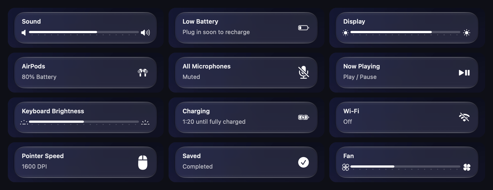
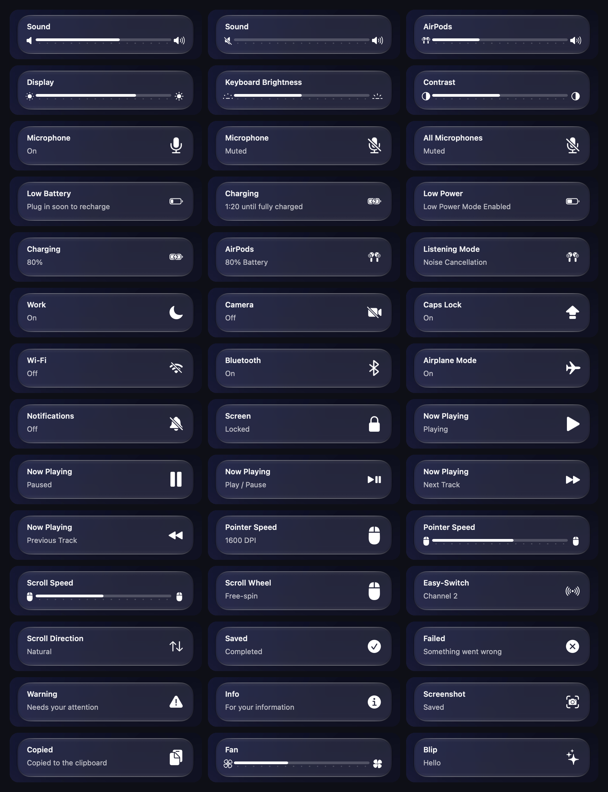

<h1 align="center">🫧 Blip</h1>

<p align="center">
  <b>The macOS 26 Liquid Glass system banner, for your own apps and scripts.</b><br>
  An exact copy of the volume / brightness popup. One look, no knobs.
</p>

<p align="center">
  
</p>

## 🤔 Why Blip exists

On Liquid Glass macOS, apps can't show the system's own banners. They're drawn by a private system
process that only answers to Apple's components, and despite a lot of research, no public or private
interface turned up that lets another app call them. The private OSD interface that older tools
relied on can only show the old, pre-Liquid Glass design.

So Blip draws the banner itself. Its look was painstakingly matched to the native one, compared
pixel by pixel against the real banner across every Liquid Glass setting (clear and tinted), light
and dark appearance, and backgrounds from plain to busy, so your app's feedback looks like it belongs
to the system. 🎯

## ✨ What you get

- 🪟 **The real glass.** Blur, lensing, edge light and tint that follow *System Settings → Liquid Glass*.
- 🎚️ **Everything the system banner does.** Slider with ticks, hover close button, glassy held knob, spring animation from the top edge.
- 🌍 **Native wording.** "Sound", "Low Battery" and friends come from macOS's own localization.
- ⚡ **Fast and simple.** Show a banner while another is up and it updates in place.
- 🖥️ **Any display**, plus a **`blip` command** for shell scripts and a **C interface** for Rust, C and C++.

Requires macOS 10.15+ (the glass look needs macOS 26; older systems get a dark HUD). Building needs Xcode 26+.

## 📦 Install

```swift
.package(url: "https://github.com/sidevesh/blip", from: "0.5.0")
// then: .product(name: "Blip", package: "blip")
```

Command line tool:

```sh
git clone https://github.com/sidevesh/blip && cd blip
swift build -c release --product blip && cp .build/release/blip ~/.local/bin/
```

## 🚀 Use it

```swift
import Blip

Blip.shared.show(.volume(level: 0.4))
Blip.shared.show(.lowBattery())
Blip.shared.show(.accessory(name: "AirPods Pro", batteryPercent: 80))
Blip.shared.show(.message(title: "Wi-Fi", message: "Disconnected", icon: .system(.wifiOff)))
```

Like the system's, every banner has two rows: a title over a slider, or a title over a second line.
There is no title-only banner, so `.message` and `.status` always take a `message`.

`show` works from any thread; the process just needs an AppKit event loop (every app has one, and a
command line tool can wrap its work in `Blip.shared.runUntilDismissed { … }`).

## 🧩 Banners

Every preset, as a Swift call and as a `blip` command:

| | Swift | `blip` |
| --- | --- | --- |
| 🔊 **Sound** | `.volume(level:muted:)` | `volume` · `mute` |
| | `.soundOutput(device:level:)` | `sound-output --title NAME` |
| | `.media(.play / .pause / .playPause / .next / .previous)` ("Now Playing" over the action) | `play` · `pause` · `play-pause` · `next` · `previous` |
| ☀️ **Display** | `.brightness(level:)` · `.keyboardBrightness(level:)` · `.contrast(level:)` | `brightness` · `keyboard-brightness` · `contrast` |
| 🎙️ **Microphone** | `.microphone(muted:)` · `.allMicrophones(muted:)` | `microphone` · `microphone-muted` · `all-microphones` |
| 🔋 **Power** | `.lowBattery()` · `.charging(timeUntilFull:)` · `.lowPowerMode()` · `.battery(percent:charging:)` | `low-battery` · `charging` · `low-power` · `battery` |
| 🎧 **Accessories** | `.accessory(name:batteryPercent:)` · `.listeningMode(_:)` · `.focus(name:on:)` | `accessory` · `listening-mode` · `focus` |
| 🔘 **On / off** | `.camera(on:)` · `.capsLock(on:)` · `.wifi(on:)` · `.bluetooth(on:)` · `.airplaneMode(on:)` · `.notifications(on:)` · `.screenLock(locked:)` | `camera` · `caps-lock` · `wifi` · `bluetooth` · `airplane-mode` · `notifications` · `screen-lock` (`--off` for off) |
| 🖱️ **Mouse** | `.dpi(_:device:)` · `.pointerSpeed(level:)` · `.scrollSpeed(level:)` · `.smartShift(freeSpin:)` · `.easySwitch(channel:device:)` · `.scrollDirection(natural:)` | `dpi` · `pointer-speed` · `scroll-speed` · `smart-shift` · `easy-switch` · `scroll-direction` |
| 💬 **Notices** | `.status(.success / .error / .warning / .info, title:message:)` · `.screenshot()` · `.clipboardCopied()` | `success` · `error` · `warning` · `info` · `screenshot` · `clipboard` |
| 🛠️ **Custom** | `.slider(title:level:leading:trailing:)` · `.message(title:message:icon:)` · `.toggle(title:on:icon:)` | `slider` · `message` |

<details>
<summary>🖼️ <b>See all 42 banners</b></summary>
<br>

</details>

**Icons:** `.system(.keyboardBrightnessHigh)` (56 built-ins matching the system's), `.symbol("sparkles")`
(any SF Symbol), `.image(nsImage)` or `.file(url)`. `BlipSystemIcon.allCases` lists them all.

## 🎛️ Interaction

Banners are click-through unless `isInteractive` is set. Then they report what the user does:

```swift
let handle = Blip.shared.show(.volume(level: 0.2), handlers: BlipHandlers(
  onLevelChange: { level in … },   // while dragging, 0...1
  onStep:        { step in … },    // an end icon was clicked: .decrease / .increase
  onTap:         { … },            // the banner was clicked
  onDismiss:     { reason in … }   // .timeout / .programmatic
))
handle.update(level: 0.6)          // move the slider
handle.dismiss()
```

Choose the display with `on:` — `.main` (default), `.pointer`, `.display(id)` or `.all`.

## ⌨️ Command line

```sh
blip volume --level 0.4
blip low-battery
blip accessory --title "AirPods Pro" --percent 80
blip all-microphones --muted --background       # returns at once: ideal for hotkey scripts
blip message --icon wifi-off --title "Wi-Fi" --message "Disconnected"
blip slider --title Fan --icon sf:fan --trailing-icon sf:fan.fill --interactive --events
```

| Option | |
| --- | --- |
| `--level N` | slider position, 0–1 (or 0–100) |
| `--title` `--message` | text |
| `--icon` `--trailing-icon` | built-in name, `sf:SYMBOL` or an image path |
| `--muted` `--off` `--percent` `--charging` `--value` `--time-until-full` | preset state |
| `--duration S` | seconds before fading (`0` = until clicked) |
| `--display` | `main`, `pointer`, `all` or a display ID |
| `--interactive` `--events` | allow dragging; print events as JSON lines |
| `--background` | return immediately, keep the banner alive |

`blip demo` plays every banner, `blip list-presets` and `blip list-icons` list what's available.

## 🦀 Rust, C and C++

`swift build -c release --product BlipC` builds `libBlipC.a`, a static library with three functions,
safe to call from any thread:

```c
void blip_c_slider(const char *title, double level, const char *leading_icon, const char *trailing_icon);
int  blip_c_message(const char *title, const char *message, const char *icon);  /* 0, or -1 if message is NULL/empty */
void blip_c_dismiss(void);
```

Icons are the names `blip list-icons` prints, or any SF Symbol name. The host needs a running AppKit
loop, and the link line needs `-L/usr/lib/swift` and the SDK's `usr/lib/swift`.

## 🔬 How it works

The banner is Apple's own `NSGlassEffectView`, tuned from the inside: its private `glassBackground`
filter supplies the edge refraction and the blur, its two edge-shading layers (which light a
rectangle in the middle) are hidden, and Blip draws the system banner's thin edge light on top. The
look was fitted to pixel captures of the real banner over a dark wallpaper and over colour stripes,
and follows the Liquid Glass tint. The layout, close button, held knob and spring (response 0.487,
critically damped) were read from ControlCenter's own banner code. It uses private AppKit and
CoreAnimation interfaces, so it is not for the Mac App Store.

## 🤝 Contributing

Issues and pull requests are welcome, especially where a banner differs from what macOS shows
(screenshots help!). `blip tuner` shows Blip under the system's banner over several backgrounds for
comparing, and `Scripts/screenshots.sh` rebuilds the images here. Run `swift test` first. MIT licensed.
